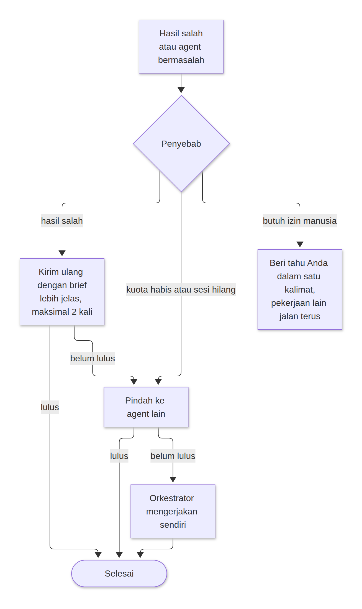

# rempug

[](https://github.com/dianramdhani/rempug/actions/workflows/release.yml)
[](https://www.npmjs.com/package/rempug)
[](LICENSE)

**Bagi pekerjaan ke beberapa agent AI di tmux tanpa boros token, tanpa tertipu laporan palsu, dan tanpa Anda harus jadi kurir.**

Anda punya Claude Code, Codex, Antigravity, atau opencode, dan masing-masing berjalan di terminalnya sendiri. Langganan agent seperti ini umumnya hanya bisa dipakai lewat CLI, bukan API. Anda ingin satu agent memimpin sementara yang lain bekerja secara paralel. rempug menjembatani keduanya: cukup ketik `/rempug` di orkestrator, lalu nilai apakah hasilnya benar.

## Masalah yang hampir pasti Anda temui

Begitu Anda menyuruh satu agent meminta agent lain mengerjakan sesuatu, masalah yang sama akan muncul:

| Masalah | Apa yang terjadi |
|---|---|
| **Anda jadi kurir** | Anda menyalin tugas dari satu terminal ke terminal lain, lalu membawa hasilnya kembali. Orkestrator tinggal mengatur, sementara Anda yang mengangkut. |
| **Membaca layar tmux itu boros dan rapuh** | `capture-pane` mengembalikan kotak, garis, spinner, dan riwayat percakapan. Orkestrator membayar token hanya untuk membaca sampah visual, dan tetap bisa salah menafsirkannya. |
| **Perintah yang "terkirim" belum tentu sampai** | Tiap TUI berperilaku berbeda: ada yang menelan Enter pertama, ada yang hanya menerima paste, ada yang menyimpan teks di kotak input tanpa mengirimnya. Tugas macet tanpa ada yang tahu. |
| **Agent murah sering mengaku sudah selesai** | "Sudah beres!" padahal tes gagal, file lain ikut berubah, atau ada commit yang tidak diminta. Memeriksanya satu per satu memakan waktu dan token. |
| **Orkestrator tidak tahu kapan agent selesai** | Anda yang harus mengingatkan, "agent itu sudah selesai, coba cek." Anda berubah jadi alarm. |
| **Dua agent menimpa file yang sama** | Satu working tree dipakai bersama, tanpa pembatas. |
| **Skrip koordinasi buatan sendiri mengotori repo** | Ratusan berkas `tasks/`, `state/`, dan `evidence/` menumpuk di repo, hanya dimengerti agent, lalu ikut ter-commit. |

## Cara rempug mengatasinya

| Tanpa rempug | Dengan rempug |
|---|---|
| Anda menyalin tugas ke tiap terminal | Orkestrator mengirim tugas sendiri: cukup **satu baris** diketik ke agent, dan agent membaca isi lengkapnya lewat perintah |
| Orkestrator membaca layar mentah | Hasil kembali lewat **perintah**, dan orkestrator hanya menerima **satu baris per kejadian** |
| Cara mengirim ditebak, lalu tugas macet | Tiap agent **diukur** dulu (probe) untuk mengetahui cara mengirim yang benar-benar sampai |
| Percaya pada pengakuan agent | rempug **menghitung sendiri**: berkas yang berubah, hasil tes, dan commit diam-diam |
| Anda mengingatkan orkestrator | Kejadian **dikirim langsung** ke orkestrator, dan posisi terakhir yang sudah disampaikan tersimpan sehingga tidak ada yang terlewat |
| Dua agent bentrok | Tugas yang cakupan berkasnya beririsan **ditolak** sebelum dikirim |
| Berkas koordinasi di dalam repo | Semuanya disimpan di **satu berkas SQLite di luar repo**, jadi repo Anda tidak tersentuh |
| Laporan penuh kode tugas dan istilah teknis | Laporan untuk Anda **berupa kalimat biasa** |

Anda cukup mengetik `/rempug` sekali. Setelah itu orkestrator memutuskan sendiri apa yang dibagikan, lalu menunggu, memeriksa, mengulang, dan memindahkan pekerjaan bila ada agent yang bermasalah.

## Cara kerja

Gambaran besarnya:

<p align="center"></p>

Satu tugas dari awal sampai akhir. Perhatikan bahwa rempug tidak mempercayai klaim agent sebelum memeriksanya sendiri:

<p align="center"></p>

Bila ada yang tidak beres, orkestrator menempuh tangga di bawah ini dan baru melibatkan Anda sebagai langkah terakhir:

<p align="center"></p>

**Permintaan izin dari agent tidak pernah dijawab otomatis.** Bila agent menunggu persetujuan, rempug hanya melaporkannya kepada Anda.

### Yang dilakukan rempug di balik layar

- **Probe saat `/rempug`**: mengirim tugas uji ke tiap agent untuk mengukur cara kirim yang berhasil, waktu responsnya, dan tampilan layarnya saat sibuk. Agent yang gagal ditandai `tidak-andal` dan tidak dipakai.
- **Konfirmasi pemahaman**: sebelum bekerja, agent harus menyebutkan cakupan, cek, dan rencananya. Bila cocok dengan brief, mesin langsung menyetujui tanpa memakai token orkestrator. Bila menyimpang (misalnya rencananya menyentuh `package.json`), tugas ditahan.
- **Verifikasi oleh mesin**: rempug memeriksa berkas yang berubah beserta jumlah barisnya, perubahan di luar cakupan (hanya nama berkas, karena bisa jadi itu edit Anda sendiri), cek penerimaan yang ia jalankan sendiri, serta commit atau pindah branch.
- **Pemantau layar**: mengulang pengiriman yang tertahan; melaporkan pertanyaan, permintaan izin, dan kuota habis; mengirim satu pengingat; lalu menyatakan agent macet bila tetap tidak ada kemajuan.

## Contoh hasil

Satu baris per tugas untuk dibaca orkestrator (nilainya contoh, bentuknya sesuai aslinya):

```
T12 codex ✓ 1 file +3/−1 | scope OK | tsc ✓ biome ✓
T13 agy ⚠ pelanggaran: HEAD berubah (a1b2c3d→e4f5a6b)
```

Yang sampai kepada Anda, dalam kalimat biasa (`rempug report --manusia`):

```
Selesai (1)
- Ubah kolom tabel Devices (oleh codex): mengubah 1 berkas (3 baris ditambah, 1 dihapus); semua pengecekan lulus

Perlu perhatian (1)
- Ubah tema (oleh agy): mengubah riwayat git tanpa izin (membuat commit atau berpindah cabang); hasilnya tidak dipercaya
```

## Kebutuhan

- Linux atau macOS (butuh `tmux`)
- Node.js 22.13 atau lebih baru (memakai `node:sqlite` bawaan, tanpa dependensi native)
- Agent pekerja yang bisa menjalankan perintah shell (misalnya Codex, Antigravity, atau opencode)

## Pemasangan

```bash
npm i -g rempug
```

Perintah `rempug` harus ada di PATH, karena hook sesi dan agent pekerja memanggilnya dari shell (`rempug doctor` bisa memeriksanya). Setelah itu pasang skill dan server MCP untuk Claude Code. **Pilih salah satu cara saja:**

```bash
# A. Plugin: skill /rempug, server MCP, dan hook awal sesi sekaligus
claude plugin marketplace add dianramdhani/rempug
claude plugin install rempug@rempug

# B. Manual
rempug skill install
claude mcp add --scope user rempug -- rempug mcp
```

`rempug skill install` hanya menyalin satu berkas petunjuk ke `~/.claude/skills/rempug/`. Berkas itulah yang memberi tahu Claude kapan dan bagaimana memakai rempug, sekaligus membuat `/rempug` dikenali. Karena letaknya di tingkat user, ia berlaku untuk semua proyek dan **tidak menulis apa pun ke repo Anda**. Mulai sesi Claude Code yang baru jika `/rempug` belum muncul. Biaya tetap plugin sekitar 74 token per sesi (angka dari `claude plugin details`).

## Pemakaian

Siapkan sesi tmux, jalankan agent di dalamnya, dan siapkan apa pun yang mereka butuhkan (misalnya sesi Playwright). Lalu ketik di orkestrator:

```
/rempug
```

Orkestrator akan memindai tmux, menebak mana yang agent, menanyakan nama **sekali saja**, lalu menguji tiap agent dan menampilkan kesiapannya, misalnya:

```
agy       ✓ siap  ack 5.7 dtk
codex     ✓ siap  ack 6.1 dtk
opencode  ✗ tidak-andal  agent melaporkan galat (limit, kuota, atau autentikasi)
```

Sesudah itu Anda cukup meminta hasil. Hook awal sesi memulihkan status di sesi berikutnya, jadi `/rempug` tidak perlu diulang.

## Status pengujian: yang sudah dan belum

| | Status |
|---|---|
| 283 uji otomatis, termasuk uji ujung ke ujung dengan tmux dan git sungguhan | Lulus di CI: Ubuntu (Node 22.13, 24, 26) dan macOS (Node 24) |
| **Claude Code sebagai orkestrator** | **Diuji dan dipakai** |
| Codex dan Antigravity sebagai **pekerja** | Diuji dengan agent asli: lolos probe, dan dua tugas edit paralel selesai serta terverifikasi |
| opencode sebagai pekerja | Pengiriman berhasil, tetapi saat diuji akunnya gagal login (galat 401), jadi alurnya belum terbukti |
| **Codex, Antigravity, atau opencode sebagai orkestrator** | **Belum dicoba** |
| Claude sebagai pekerja | Belum dicoba |

### Orkestrator selain Claude Code

**Belum dicoba.** Perintah `rempug` dan server MCP-nya mengikuti standar, jadi mungkin saja berfungsi di orkestrator lain. Namun bagian yang paling terikat ke Claude Code belum punya padanan yang teruji:

- skill `/rempug`, plugin, dan hook sesi memakai format Claude Code;
- orkestrator dibangunkan lewat tool `Monitor` milik Claude Code. Untuk yang lain ada cadangan (`rempug watch --bangun`) yang mengetik satu baris ke layar orkestrator saat layarnya diam, tetapi baru diuji dengan tiruan, belum dengan agent sungguhan.

Jika Anda mencobanya dengan orkestrator lain, laporan hasilnya sangat berguna; silakan buka issue.

## Perintah

Untuk orkestrator: `scan`, `register`, `probe`, `ls`, `status`, `doctor`, `send`, `jawab`, `log`, `show`, `diff`, `report`, `layar`, `watch`, `terima`.
Untuk agent pekerja: `brief`, `paham`, `tunggu`, `reply`.
Semuanya juga tersedia sebagai tool MCP (`rempug mcp`), kecuali `watch`. Jalankan `rempug --help` untuk melihat pemakaian lengkap. `rempug report --manusia` menghasilkan laporan berkalimat biasa, tanpa kode tugas dan simbol.

## Konfigurasi

| Variabel | Fungsi | Bawaan |
|---|---|---|
| `XDG_STATE_HOME` | Lokasi ledger (`rempug/ledger.db`) | `~/.local/state` |
| `XDG_CONFIG_HOME` | Lokasi registry agent | `~/.config` |
| `REMPUG_RETENTION_DAYS` | Berapa hari tugas disimpan | 30 |
| `REMPUG_ACK_DETIK` | Batas waktu (detik) menunggu agent membaca brief | 45 |
| `REMPUG_DIAM_DETIK` | Layar yang tidak berubah selama ini (detik) dianggap diam | 10 |
| `REMPUG_MACET_DETIK` | Diam selama ini (detik) tanpa balasan berarti macet | 120 |
| `REMPUG_WATCH_MS` | Selang pemeriksaan `watch` (milidetik) | 1000 |
| `REMPUG_TMUX_SOCKET` | Memakai server tmux lain (`tmux -L`) | server bawaan |
| `CLAUDE_CONFIG_DIR` | Lokasi pemasangan skill | `~/.claude` |

## Batasan yang perlu diketahui

- **Deteksi keadaan dari layar bersifat perkiraan** (teks tertahan, pertanyaan, permintaan izin, kuota habis). Perkiraan ini teruji pada TUI tiruan yang meniru berbagai perilaku dan pada Codex serta Antigravity asli, tetapi belum divalidasi untuk setiap TUI. Agent yang gagal probe tidak dipakai.
- Konfirmasi pemahaman menangkap salah paham soal **cakupan, cek, dan tindakan terlarang**, tetapi tidak salah paham soal makna tujuan. Untuk tugas berisiko, gunakan `--teliti`; verifikasi setelah kerja tetap menjadi jaring pengaman terakhir.
- Pemeriksaan cakupan sengaja **konservatif**: path tanpa wildcard dianggap mencakup dirinya sendiri beserta isinya. Akibatnya, tugas yang sebenarnya aman kadang ditolak; itu lebih baik daripada membiarkan dua agent menimpa file yang sama.
- Pada tugas `baca` dan `browser`, isi `CEK` adalah deskripsi bukti yang harus dilaporkan agent, bukan perintah yang dijalankan. Perintah shell hanya dijalankan untuk tugas `edit`.
- Beberapa agent berbagi satu working tree dan branch. Commit Anda atau orkestrator saat tugas berjalan hanya menjadi **peringatan**. Yang dianggap pelanggaran adalah pindah branch, menulis ulang riwayat, atau commit yang mengubah berkas di cakupan tugas itu sendiri.
- Pemeriksaan rencana hanya membatasi **penulisan** di luar cakupan. Menyebut berkas lain untuk dibaca (misalnya pada tugas audit) tidak menahan tugas, dan pemeriksaan perubahan nyata setelah tugas selesai tetap menjadi jaring pengaman terakhir.
- **Penanda "sedang bekerja" dari layar baru divalidasi untuk codex 0.171 dan Antigravity 1.5**, dengan agent asli yang menjalankan perintah selama 70 detik. Selama penanda itu tampil, rempug tidak mengetik pengingat dan tidak menyatakan agent macet. Untuk agent lain, rempug hanya melihat apakah layar berubah, sehingga bisa keliru pada perintah panjang yang tidak mengubah layar.
- Tugas yang sempat ditandai macet akan kembali berjalan sendiri bila layar agent bergerak lagi atau penanda sibuk muncul. Cek yang gagal diulang satu kali sebelum dinyatakan gagal, karena beberapa agent bisa menjalankan tes berat bersamaan di satu mesin.
- Windows tidak didukung (tmux).

## Pengembangan

```bash
npm ci
npm run check       # Biome
npm run typecheck
npm test            # butuh tmux; termasuk uji ujung ke ujung
```

Commit mengikuti [Conventional Commits](https://www.conventionalcommits.org/). Versi, `CHANGELOG.md`, GitHub Release, dan publikasi npm dibuat otomatis oleh semantic-release dari cabang `main`.

## Lisensi

MIT
