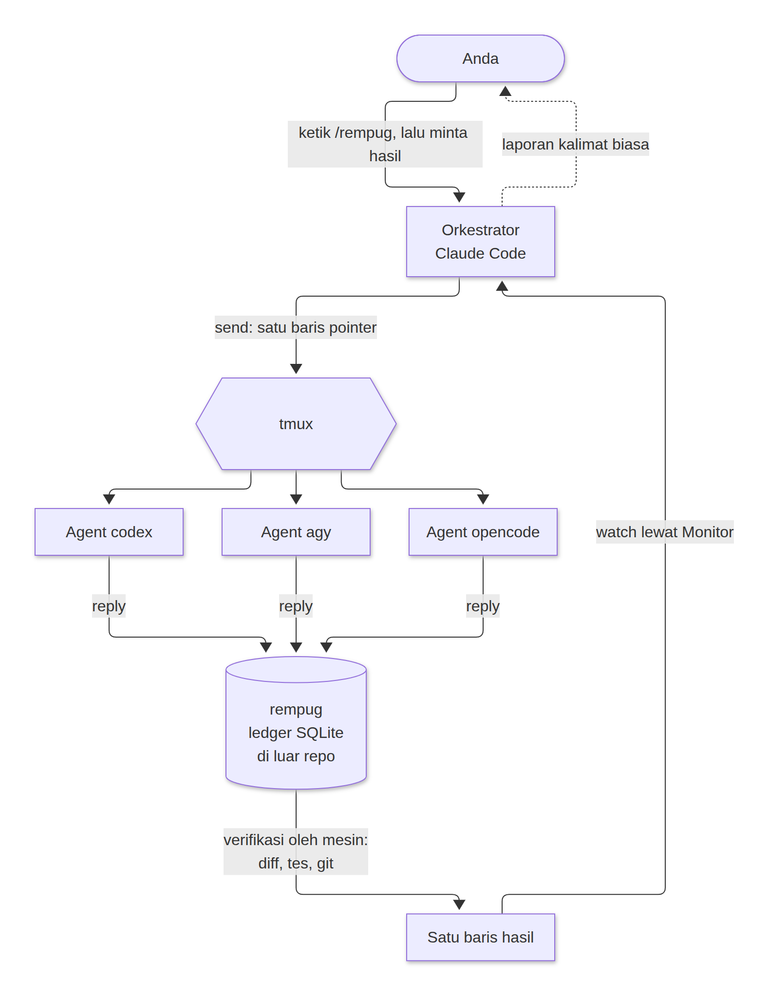
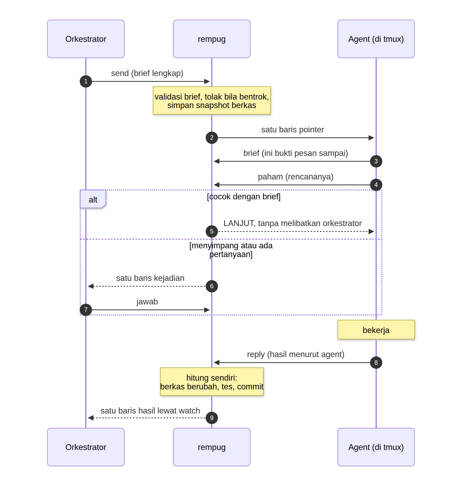

# rempug

[](https://github.com/dianramdhani/rempug/actions/workflows/release.yml)
[](https://www.npmjs.com/package/rempug)
[](LICENSE)

**Bagi pekerjaan ke banyak agent AI di tmux tanpa membakar token, tanpa dibohongi, dan tanpa Anda jadi kurir.**

Anda punya Claude Code, Codex, Antigravity, atau opencode. Masing-masing jalan di terminal, dan langganannya hanya bisa dipakai lewat CLI, bukan API. Anda ingin satu agent memimpin dan yang lain bekerja paralel. rempug adalah jembatannya: satu perintah `/rempug` di orkestrator, lalu Anda hanya menilai apakah hasilnya benar.

## Kendala yang dihadapi siapa pun yang mencobanya

Siapa pun yang pernah menyuruh satu agent "tolong minta agent lain mengerjakan ini" akan bertemu masalah yang sama:

| Kendala | Yang sebenarnya terjadi |
|---|---|
| **Anda jadi kurir** | Menyalin tugas dari satu terminal ke terminal lain, lalu membawa hasilnya kembali. Orkestrator hanya mengelola, Anda yang mengangkut. |
| **Membaca layar tmux itu boros dan rapuh** | `capture-pane` mengembalikan kotak, garis, spinner, dan riwayat. Orkestrator membayar token untuk membaca noise, lalu masih bisa salah tafsir. |
| **Perintah "terkirim" belum tentu sampai** | Tiap TUI beda: ada yang menelan Enter pertama, ada yang hanya menerima paste, ada yang menahan teks di kotak input. Tugas diam-diam nyangkut. |
| **Agent murah suka mengaku selesai** | "Sudah beres!" padahal tes gagal, file lain ikut berubah, atau ada commit yang tidak diminta. Memeriksanya satu per satu memakan waktu dan token. |
| **Orkestrator tidak tahu agent sudah selesai** | Anda yang harus mengingatkan: "itu agent sudah selesai, coba cek". Anda jadi alarm. |
| **Dua agent menimpa file yang sama** | Satu working tree, dua agent, tanpa pagar. |
| **Skrip koordinasi buatan sendiri menumpuk sampah** | Ratusan berkas `tasks/`, `state/`, `evidence/` di repo, hanya dimengerti agent, ikut ter-commit. |

## Cara rempug menyelesaikannya

| Tanpa rempug | Dengan rempug |
|---|---|
| Anda menyalin tugas ke tiap terminal | Orkestrator mengirim tugas sendiri: **satu baris** diketik ke agent, isi lengkapnya dibaca agent lewat perintah |
| Orkestrator membaca layar mentah | Hasil kembali lewat **perintah**, dan orkestrator hanya menerima **satu baris per kejadian** |
| Cara kirim ditebak, lalu nyangkut | Tiap agent **diukur** dulu (probe): teknik kirim mana yang benar-benar sampai |
| Percaya pengakuan agent | rempug **menghitung sendiri**: berkas yang berubah, hasil tes, commit diam-diam |
| Anda mengingatkan orkestrator | Kejadian **didorong** ke orkestrator, dengan kursor tersimpan sehingga tidak ada yang terlewat |
| Dua agent bentrok | Tugas yang cakupan berkasnya beririsan **ditolak** sebelum dikirim |
| Berkas koordinasi di repo | Semua di **satu berkas SQLite di luar repo**. Repo Anda tidak disentuh |
| Laporan penuh kode tugas dan istilah teknis | Laporan ke Anda **berupa kalimat biasa** |

Anda hanya mengetik `/rempug` sekali. Sesudahnya orkestrator memutuskan sendiri apa yang dibagi, menunggu, memeriksa, mengulang, dan memindahkan pekerjaan kalau agent bermasalah.

## Cara kerja

Gambaran besarnya:

<p align="center"></p>

Satu tugas dari awal sampai akhir. Perhatikan bahwa agent **tidak pernah dipercaya** sampai rempug memeriksanya sendiri:

<p align="center"></p>

Bila ada yang tidak beres, orkestrator naik tangga ini dan baru melibatkan Anda di akhir:

<p align="center"></p>

**Prompt izin tidak pernah dijawab otomatis.** Kalau sebuah agent menunggu persetujuan, rempug hanya melaporkannya kepada Anda.

### Yang dilakukan rempug di balik layar

- **Probe saat `/rempug`**: mengirim tugas uji ke tiap agent dan mengukur teknik kirim yang sampai, waktu respons, dan seperti apa layarnya saat sibuk. Agent yang gagal ditandai `tidak-andal` dan tidak dipakai.
- **Konfirmasi pemahaman**: agent harus menyebut cakupan, cek, dan rencananya dulu. Kalau cocok dengan brief, disetujui mesin tanpa token orkestrator. Kalau menyimpang (misalnya rencananya menyentuh `package.json`), ditahan.
- **Verifikasi oleh mesin**: berkas yang berubah beserta jumlah barisnya, perubahan di luar cakupan (hanya nama berkas, karena bisa jadi edit Anda sendiri), cek penerimaan yang dijalankan rempug, dan commit atau pindah branch.
- **Pemantau layar**: mengulang pengiriman yang tertahan, melaporkan pertanyaan, prompt izin, dan kuota habis, mengirim satu pengingat, lalu menyatakan agent macet.

## Contoh hasil

Satu baris per tugas, yang dibaca orkestrator (nilainya contoh, bentuknya nyata):

```
T12 codex ✓ 1 file +3/−1 | scope OK | tsc ✓ biome ✓
T13 agy ⚠ pelanggaran: HEAD berubah (a1b2c3d→e4f5a6b)
```

Yang sampai kepada Anda, dalam kalimat biasa (`rempug report --manusia`):

```
Selesai (1)
- Ubah kolom tabel Devices (oleh codex): mengubah 1 berkas (3 baris ditambah, 1 dihapus); semua pengecekan lulus

Perlu perhatian (1)
- Ubah tema (oleh agy): mengubah riwayat git tanpa izin (membuat commit atau berpindah cabang); hasilnya tidak dipercaya
```

## Kebutuhan

- Linux atau macOS (butuh `tmux`)
- Node.js 22.13 atau lebih baru (memakai `node:sqlite` bawaan, tanpa dependensi native)
- Agent pekerja yang bisa menjalankan perintah shell (Codex, Antigravity, opencode, dan sebagainya)

## Pemasangan

```bash
npm i -g rempug
```

Perintah `rempug` harus ada di PATH: hook sesi dan agent pekerja memanggilnya dari shell (`rempug doctor` memeriksanya). Lalu pasang skill dan server MCP untuk Claude Code. **Pilih salah satu, bukan keduanya:**

```bash
# A. Plugin: skill /rempug + server MCP + hook awal sesi, sekaligus
claude plugin marketplace add dianramdhani/rempug
claude plugin install rempug@rempug

# B. Manual
rempug skill install
claude mcp add --scope user rempug -- rempug mcp
```

`rempug skill install` hanya menyalin satu berkas petunjuk ke `~/.claude/skills/rempug/`. Itu yang membuat Claude tahu kapan dan bagaimana memakai rempug, dan yang membuat `/rempug` dikenali. Letaknya di tingkat user, jadi berlaku untuk semua proyek dan **tidak ada yang ditulis ke repo Anda**. Mulai sesi Claude Code yang baru bila `/rempug` belum muncul. Biaya tetap plugin sekitar 74 token per sesi (angka dari `claude plugin details`).

## Pemakaian

Siapkan sesi tmux dan jalankan agent di dalamnya, beserta apa pun yang perlu disiapkan (misalnya sesi Playwright). Lalu di orkestrator:

```
/rempug
```

Orkestrator memindai tmux, menebak mana yang agent, bertanya **satu kali** untuk penamaan, lalu menguji tiap agent dan menampilkan kesiapannya, misalnya:

```
agy       ✓ siap  ack 5.7 dtk
codex     ✓ siap  ack 6.1 dtk
opencode  ✗ tidak-andal  agent melaporkan galat (limit, kuota, atau autentikasi)
```

Sesudah itu Anda cukup meminta hasil. Hook awal sesi memulihkan status di sesi berikutnya, jadi `/rempug` tidak perlu diulang.

## Status pengujian: yang sudah dan belum

| | Status |
|---|---|
| 247 uji otomatis, termasuk uji ujung ke ujung dengan tmux dan git nyata | Lulus di CI: Ubuntu (Node 22.13, 24, 26) dan macOS (Node 24) |
| **Claude Code sebagai orkestrator** | **Diuji dan dipakai** |
| Codex dan Antigravity sebagai **pekerja** | Diuji dengan agent asli: lulus probe, dan dua tugas edit paralel selesai dan terverifikasi |
| opencode sebagai pekerja | Pengiriman berhasil, tetapi saat uji akunnya gagal login (galat 401), jadi alurnya belum terbukti |
| **Codex, Antigravity, atau opencode sebagai orkestrator** | **Belum dicoba** |
| Claude sebagai pekerja | Belum dicoba |

### Orkestrator selain Claude Code

**Belum dicoba.** Perintah `rempug` dan server MCP-nya mengikuti standar sehingga bisa jadi berfungsi di orkestrator lain, tetapi bagian yang paling terikat ke Claude Code belum punya padanan teruji:

- skill `/rempug`, plugin, dan hook sesi adalah format Claude Code;
- orkestrator dibangunkan lewat tool `Monitor` milik Claude Code. Untuk yang lain ada cadangan (`rempug watch --bangun`) yang mengetik satu baris ke layar orkestrator saat layarnya diam, tetapi baru diuji dengan tiruan, bukan dengan agent sungguhan.

Kalau Anda mencobanya dengan orkestrator lain, hasilnya sangat berguna: silakan buka issue.

## Perintah

Untuk orkestrator: `scan`, `register`, `probe`, `ls`, `status`, `doctor`, `send`, `jawab`, `log`, `show`, `diff`, `report`, `layar`, `watch`, `terima`.
Untuk agent pekerja: `brief`, `paham`, `tunggu`, `reply`.
Semuanya juga tersedia sebagai tool MCP (`rempug mcp`), kecuali `watch`. Jalankan `rempug --help` untuk pemakaian lengkap. `rempug report --manusia` menghasilkan laporan berkalimat biasa, tanpa kode tugas dan simbol.

## Konfigurasi

| Variabel | Fungsi | Bawaan |
|---|---|---|
| `XDG_STATE_HOME` | Lokasi ledger (`rempug/ledger.db`) | `~/.local/state` |
| `XDG_CONFIG_HOME` | Lokasi registry agent | `~/.config` |
| `REMPUG_RETENTION_DAYS` | Masa simpan tugas | 30 |
| `REMPUG_ACK_DETIK` | Batas menunggu agent membaca brief | 45 |
| `REMPUG_DIAM_DETIK` | Layar tidak berubah selama ini dianggap diam | 10 |
| `REMPUG_MACET_DETIK` | Diam selama ini tanpa balasan berarti macet | 120 |
| `REMPUG_WATCH_MS` | Selang `watch` | 1000 |
| `REMPUG_TMUX_SOCKET` | Memakai server tmux lain (`tmux -L`) | server bawaan |
| `CLAUDE_CONFIG_DIR` | Lokasi pemasangan skill | `~/.claude` |

## Batasan yang perlu diketahui

- **Deteksi keadaan layar bersifat heuristik** (teks tertahan, pertanyaan, prompt izin, kuota). Ia teruji terhadap TUI palsu yang meniru perilaku berbeda dan terhadap Codex dan Antigravity asli, tetapi belum divalidasi untuk setiap TUI. Agent yang gagal probe tidak dipakai.
- Konfirmasi pemahaman menangkap salah paham pada **cakupan, cek, dan tindakan terlarang**, bukan salah paham makna pada tujuan. Untuk tugas berisiko gunakan `--teliti`; verifikasi sesudah kerja tetap menjadi jaring terakhir.
- Pengecekan cakupan sengaja **konservatif**: path tanpa wildcard dianggap sebagai dirinya sendiri beserta isinya. Kadang ia menolak tugas yang sebenarnya aman, demi tidak membiarkan dua agent menimpa file yang sama.
- Pada tugas `baca` dan `browser`, kolom `CEK` adalah deskripsi bukti yang harus dilaporkan agent, bukan perintah yang dijalankan. Perintah shell hanya dijalankan untuk tugas `edit`.
- Windows tidak didukung (tmux).

## Pengembangan

```bash
npm ci
npm run check       # Biome
npm run typecheck
npm test            # butuh tmux; termasuk uji ujung ke ujung
```

Commit mengikuti [Conventional Commits](https://www.conventionalcommits.org/). Versi, `CHANGELOG.md`, GitHub Release, dan publish npm dihasilkan otomatis oleh semantic-release dari cabang `main`.

## Lisensi

MIT
